<div align="center">



# 🛍️ Awesome Product & Pricing Catalog Management 🏷️

<p align="center">
  <a href="https://github.com/ishandutta2007/Awesome-Awesome-Awesome"></a><a href="https://discord.gg/jc4xtF58Ve"></a>
  <a href="https://awesome.re"></a>
  <a href="https://www.trackawesomelist.com/ishandutta2007/Awesome-Product-Pricing-Catalog-Management/"></a>
  <a href="LICENSE"></a>
  <a href="https://github.com/ishandutta2007"></a>
</p>

> 🚀 A curated list of top **Product and Pricing Catalog Management** platforms — including enterprise Configure, Price, Quote (CPQ) suites, subscription pricing & billing engines, and open-source alternatives for orchestrating product masters, price books, bill of materials (BOM), and complex pricing rules.
> 
> 🌟 Star this repo if you find it useful! 🌟

</div>

---

## 📋 Table of Contents

- [💡 Overview & Key Concepts](#-overview--key-concepts)
- [📈 Sector Overview & Market Dynamics](#-sector-overview--market-dynamics)
- [🟦 SaaS & Hosted Platforms](#-saas--hosted-platforms)
- [🟩 Open-Source Software](#-open-source-software)
- [📊 Feature Comparison Matrix](#-feature-comparison-matrix)
- [🎯 Selection Guide: How to Choose](#-selection-guide-how-to-choose)
- [💖 Support](#-support)
- [⭐ Star History](#-star-history)
- [🤝 Contributing](#-contributing)
- [📄 License](#-license)

---

## 💡 Overview & Key Concepts

Managing a modern product and pricing catalog requires bridging product information management (PIM), dynamic pricing calculation, discount governance, and downstream quote-to-cash systems:

- 📦 **Product Master / PIM:** Centralized single source of truth for SKUs, hierarchical product bundles, attributes, and digital assets.
- 🏷️ **Price Books & Rate Cards:** Multi-currency, multi-dimensional pricing matrices supporting flat fee, tiered, volume, usage-based, and contracted negotiated rates.
- ⚙️ **Configure, Price, Quote (CPQ):** Constraint-based configuration engines validating product combinations, calculating BOM rollups, and applying approval workflows.
- ⏱️ **Usage Metering & Rating:** Ingesting high-velocity consumption events and computing billing charges based on tiered or prepaid commitments.

---

## 📈 Sector Overview & Market Dynamics

The global Configure, Price, Quote (CPQ) and Pricing Management software market is valued at approximately **$3.5B to $4.2B (2025/2026)** and is projected to surpass **$7.5B to $8.1B by 2030**, expanding at a robust **CAGR of 15%–17%**. The sector is **moderately fragmented**: while tier-1 enterprise platforms (such as Salesforce, SAP, and Conga) anchor large-scale Fortune 500 digital transformations, specialized innovators and domain-focused CPQ/pricing engines (such as Tacton for discrete manufacturing CAD/BOM, Pricefx/Vendavo for distributor price waterfalls, and Lago/Chargebee for hybrid subscription metering) thrive across distinct verticals, preventing a single winner-take-all outcome.

---

## 🟦 SaaS & Hosted Platforms

Enterprise cloud solutions sorted in descending order of vendor scale (market valuation / enterprise capitalization):

| 🏢 Platform | 💰 Vendor Scale / Valuation | 🏷️ Starting Pricing | 🎁 Free Tier / Trial Limit | ⚡ Key Focus & Strengths |
| :--- | :--- | :--- | :--- | :--- |
| **Salesforce CPQ** | ~$250B+ Market Cap | $75 / user / month (billed annually; CPQ+ at $150 / user / month) | 90-day trial via CPQ Developer Edition & Trailhead Playground orgs | Enterprise CPQ with layered pricing exceptions, block pricing, percent-of-total rules, and multi-tier price books. |
| **Chargebee** | $3.5B Valuation | $599 / month (Performance tier billed annually; legacy Starter at $0 + 0.75% overage) | Free up to $250,000 in cumulative lifetime billing (Starter tier; no credit card required) | Billing-native catalog supporting flat-fee, stairstep, tiered, seat, and SQL-metered usage models up to 30-level hierarchies. |
| **Zuora** | ~$1.5B Enterprise Value | Custom quote-based (Entry/Launch plans scale by ARR/volume; typically $1,000+/mo) | 14-day to 30-day guided sandbox access upon sales qualification (No open self-serve tier) | Multi-entity, multi-currency product catalog designed for high-volume enterprise subscription and consumption revenue recognition. |
| **Conga CPQ** | ~$400M ARR (Private) | $35 – $85 / user / month (Enterprise deployments typically start at $150/user/mo) | No public free trial; guided sandbox environment available through enterprise sales demo | Unified CPQ Admin console for catalog hierarchy, category trees, and rule-based price list item associations. |
| **Pricefx** | ~$85M ARR (Private) | Custom quote-based (Annual enterprise licensing typically starts north of $60,000/yr) | No open free tier; custom proof-of-concept (PoC) environment provided upon request | AI-driven dynamic pricing, price waterfall analytics, margin leakage protection, and real-time cost-to-price synchronization. |
| **Vendavo** | ~$75M ARR (Private) | Custom quote-based (Enterprise contracts typically start at $80,000 – $100,000+/yr) | No open free tier; custom proof-of-concept environment provided via sales consultation | B2B price optimization for massive SKU catalogs, cost volatility tracking, bracket pricing, and rebate management. |
| **DealHub** | ~$55M ARR / $100M+ Funding | Custom quote-based (Mid-market implementations average $60 – $100 / user / month) | No open free tier; personalized live product walkthrough and custom sandbox demo on request | Adaptive Pricebook with hierarchical bundling, SOLID/ERP/FROM_ALL_QUOTE pricing types, and headless CPQ quoting. |
| **Tacton CPQ** | ~$45M ARR (Private) | Custom quote-based (Heavy manufacturing setups typically range $80,000 – $150,000+/yr) | No open free tier; guided pilot and technical feasibility sandbox via sales evaluation | Constraint-based 3D visual configuration, multi-level BOM generation, and engineering CAD/ERP integration for manufacturing. |

---

## 🟩 Open-Source Software

Community-driven, self-hostable product catalogs, pricing engines, usage metering frameworks, and PIM repositories sorted in descending order by GitHub_Stars:

### 1. 💼 Odoo (Product & Pricelist)
[](https://github.com/odoo/odoo/stargazers)
- **Repository:** [odoo/odoo](https://github.com/odoo/odoo)
- **Stack:** 🐍 Python, 🟨 JavaScript, 🐘 PostgreSQL | **License:** LGPL-3.0
- **Overview:** Fully featured ERP suite with native **Product & Pricelist** management. Supports advanced pricing rules, currency conversions, margin computations, volume discounts, and customer-specific price books.
- **Best For:** Organizations seeking a complete business management suite with integrated catalog and pricing workflows.

### 2. 📦 ERPNext (Item & Price List)
[](https://github.com/frappe/erpnext/stargazers)
- **Repository:** [frappe/erpnext](https://github.com/frappe/erpnext)
- **Stack:** 🐍 Python, ☕ Frappe Framework, 🐬 MariaDB | **License:** GPL-3.0
- **Overview:** Open-source ERP providing granular **Item Master** configuration (variants, attributes, UOMs, serials) paired with versatile **Price Lists** segmented by currency, territory, and customer groups.
- **Best For:** Teams wanting self-hosted, customizable item masters and multi-currency pricing integrated with manufacturing and sales.

### 3. 🛍️ Medusa (Pricing & Product Module)
[](https://github.com/medusajs/medusa/stargazers)
- **Repository:** [medusajs/medusa](https://github.com/medusajs/medusa)
- **Stack:** 🟩 Node.js, 🟦 TypeScript, 🐘 PostgreSQL | **License:** MIT
- **Overview:** Headless commerce engine featuring dedicated `@medusajs/pricing` and `@medusajs/product` modules. Provides price lists, multi-currency rule sets, quantity tiers, and promotion engines via headless APIs.
- **Best For:** Developers building bespoke digital commerce platforms needing API-first pricing engine microservices.

### 4. 🛒 Saleor
[](https://github.com/saleor/saleor/stargazers)
- **Repository:** [saleor/saleor](https://github.com/saleor/saleor)
- **Stack:** 🐍 Python, 🎸 Django, 🕸️ GraphQL, 🐘 PostgreSQL | **License:** BSD-3-Clause
- **Overview:** High-performance headless GraphQL commerce platform with multi-channel product catalogs, localized pricing, custom attribute matrices, and tax-inclusive/exclusive pricing structures.
- **Best For:** High-volume composable commerce architectures needing granular multi-channel catalog control.

### 5. 🗂️ Unopim
[](https://github.com/unopim/unopim/stargazers)
- **Repository:** [unopim/unopim](https://github.com/unopim/unopim)
- **Stack:** 🐘 PHP, 🔴 Laravel, 🐬 MySQL / 🐘 PostgreSQL | **License:** MIT
- **Overview:** Modern open-source Product Information Management (PIM) and Digital Asset Management (DAM) system engineered to manage and enrich millions of SKUs with complex attribute families.
- **Best For:** Teams requiring a robust, scalable product master foundation before layering downstream pricing algorithms.

### 6. 🦩 Lago
[](https://github.com/getlago/lago/stargazers)
- **Repository:** [getlago/lago](https://github.com/getlago/lago)
- **Stack:** 💎 Ruby on Rails, 🐹 Go, 🐘 PostgreSQL | **License:** AGPL-3.0
- **Overview:** Open-source metering and usage-based billing engine. Provides an API-driven product plan catalog supporting hybrid pricing, subscription add-ons, volume tiers, pay-as-you-go meters, and prepaid credits.
- **Best For:** SaaS, AI, and API companies looking for an open-source pricing engine to meter and rate consumption.

### 7. 💳 Kill Bill
[](https://github.com/killbill/killbill/stargazers)
- **Repository:** [killbill/killbill](https://github.com/killbill/killbill)
- **Stack:** ☕ Java, 🐬 MySQL / 🐘 PostgreSQL | **License:** Apache-2.0
- **Overview:** Enterprise-grade open-source subscription billing and payments platform. Features an XML-based catalog system supporting complex plan phases, pricing alignment, price overrides, and trial rules.
- **Best For:** Large organizations needing financial-grade subscription catalog configuration with complete data sovereignty.

### 8. 🗄️ Pimcore
[](https://github.com/pimcore/pimcore/stargazers)
- **Repository:** [pimcore/pimcore](https://github.com/pimcore/pimcore)
- **Stack:** 🐘 PHP, 🎼 Symfony, 🐬 MySQL | **License:** GPL-3.0
- **Overview:** Enterprise open-source platform combining PIM, MDM (Master Data Management), and DAM. Manages product structures, relations, multi-channel classification, and pricing asset associations.
- **Best For:** Enterprises requiring centralized master data management across complex global supply chains.

### 9. ⚡ OpenMeter
[](https://github.com/openmeterio/openmeter)
- **Repository:** [openmeterio/openmeter](https://github.com/openmeterio/openmeter)
- **Stack:** 🐹 Go, 🟡 ClickHouse, 🐘 PostgreSQL, 📨 Kafka | **License:** Apache-2.0
- **Overview:** Cloud-native, high-throughput usage metering engine that collects events at scale and maps real-time consumption into dynamic price calculations and entitlement rules.
- **Best For:** Cloud infrastructure, LLM/AI token metering, and developer platforms needing low-latency usage rating.

### 10. ⚙️ Open Mercato Product Configurator
[](https://github.com/open-mercato/open-mercato/stargazers)
- **Repository:** [open-mercato/open-mercato](https://github.com/open-mercato/open-mercato)
- **Stack:** 🟦 TypeScript, ▲ Next.js, 🐘 PostgreSQL | **License:** Open Source
- **Overview:** Modular open-source CPQ component built for configured products with dynamic rules, mathematical formulas, and Bill of Materials (BOM) rollups evaluated deterministically via a versioned JSON schema.
- **Best For:** Teams building an open-source quote-to-cash or ERP stack needing CPQ logic and BOM calculations.

### 11. 🪷 Lotus
[](https://github.com/uselotus/lotus/stargazers)
- **Repository:** [uselotus/lotus](https://github.com/uselotus/lotus)
- **Stack:** 🐍 Python, 🎸 Django, ⚛️ React, 🐘 PostgreSQL | **License:** MIT
- **Overview:** Open-source pricing and packaging infrastructure designed to launch and iterate SaaS pricing plans, track customer metric consumption, and manage self-serve product plans.
- **Best For:** Growth and engineering teams running quick pricing experiments, custom entitlements, and feature gating.

### 12. 🏷️ Akeneo PIM (Community Edition)
[](https://github.com/akeneo/pim-community-dev/stargazers)
- **Repository:** [akeneo/pim-community-dev](https://github.com/akeneo/pim-community-dev)
- **Stack:** 🐘 PHP, 🎼 Symfony, 🐬 MySQL, 🔍 Elasticsearch | **License:** OSL-3.0
- **Overview:** Industry-standard Product Information Management (PIM) system dedicated to structuring product data, attribute matrices, and multi-channel localized catalog enrichment.
- **Best For:** Omnichannel retailers and merchants harmonizing thousands of attributes and product families.

### 13. 🛡️ entirius-django-pricemanager
[](https://github.com/entirius/entirius-django-pricemanager/stargazers)
- **Repository:** [entirius/entirius-django-pricemanager](https://github.com/entirius/entirius-django-pricemanager)
- **Stack:** 🐍 Python, 🎸 Django, 🐘 PostgreSQL | **License:** MPL-2.0
- **Overview:** Lightweight Django module for modular e-commerce price management. Features net/gross tax calculation, country/channel pricing, write guards (margin floors), and complete append-only price change auditing.
- **Best For:** Python/Django developers building tailored e-commerce backends requiring historical price auditing and margin safeguards.

---

## 📊 Feature Comparison Matrix

| 🛠️ System / Tool | 📜 License Model | ☁️ Deployment | 📦 Product Master / PIM | 🏷️ Price Books / Rules | ⚙️ CPQ Configurator | ⏱️ Usage Metering | 🎯 Primary Audience |
| :--- | :--- | :--- | :--- | :--- | :--- | :--- | :--- |
| **Salesforce CPQ** | Proprietary | Cloud | ✅ Full | ✅ Price Books + Exceptions | ✅ Advanced | 🟡 Via Billing | Enterprise CRM / Direct Sales |
| **Chargebee** | Proprietary | Cloud | ✅ Full | ✅ Multi-Model Rates | 🟡 Add-on | ✅ Advanced SQL | Subscription & Usage SaaS |
| **Zuora** | Proprietary | Cloud | ✅ Multi-Entity | ✅ Rate Plans | ✅ Zuora CPQ | ✅ High-scale | Enterprise Monetization |
| **Conga CPQ** | Proprietary | Salesforce / Cloud | ✅ Catalog Admin | ✅ Price Lists | ✅ Advanced | 🟡 Partner/Add-on | Multi-tier Channel Sales |
| **Pricefx** | Proprietary | Cloud | 🟡 Integrated | ✅ AI Price Waterfall | 🟡 CPQ Module | ❌ | B2B Manufacturing / Distribution |
| **Vendavo** | Proprietary | Cloud | 🟡 Integrated | ✅ Margin & Rebates | 🟡 CPQ Module | ❌ | Large-scale SKU Distributors |
| **DealHub** | Proprietary | Cloud | ✅ Hierarchical | ✅ Adaptive Pricebook | ✅ Guided CPQ | ✅ Hybrid | Modern PLG & Sales-led Motions |
| **Tacton CPQ** | Proprietary | Cloud | ✅ CAD-integrated | ✅ BOM Pricing | ✅ 3D Constraint | ❌ | Heavy & Custom Manufacturing |
| **Odoo** | LGPL-3.0 | Self-Hosted | ✅ Full | ✅ Formulas & Rules | 🟡 Basic | 🟡 Basic | Integrated SMB / Mid-market ERP |
| **ERPNext** | GPL-3.0 | Self-Hosted | ✅ Full | ✅ Multi-Currency Lists | 🟡 BOM-driven | 🟡 Timesheet/Log | Open-source Enterprise ERP |
| **Medusa** | MIT | Self-Hosted | ✅ Module | ✅ Dynamic Price Lists | 🟡 Custom rules | ❌ | Headless Composable Commerce |
| **Saleor** | BSD-3-Clause | Self-Hosted | ✅ Channels | ✅ Channel-specific | ❌ | ❌ | Composable Omnichannel Retail |
| **Unopim** | MIT | Self-Hosted | ✅ 10M+ SKUs | ❌ External | ❌ | ❌ | High-scale Master Product Data |
| **Lago** | AGPL-3.0 | Self-Hosted | ✅ Plans | ✅ Volume/Tiered/Hybrid | ❌ | ✅ Real-time | SaaS & AI Metered Billing |
| **Kill Bill** | Apache-2.0 | Self-Hosted | ✅ XML Catalog | ✅ Overrides & Rules | ❌ | 🟡 Plugin-based | Self-hosted Enterprise Billing |
| **Pimcore** | GPL-3.0 | Self-Hosted | ✅ MDM / DAM | 🟡 Basic | ❌ | ❌ | Master Product Asset Management |
| **OpenMeter** | Apache-2.0 | Self-Hosted | 🟡 Meters | ✅ Rating Rules | ❌ | ✅ Stream (ClickHouse) | AI / Cloud Consumption Metering |
| **Open Mercato** | Open Source | Self-Hosted | ✅ Catalog | ✅ Formulas & BOM | ✅ Configurator | ❌ | Developers Building Custom CPQ |
| **Lotus** | MIT | Self-Hosted | ✅ Plans | ✅ Tiers & Add-ons | ❌ | ✅ Feature Access | SaaS Packaging Experiments |
| **Akeneo PIM** | OSL-3.0 | Self-Hosted | ✅ PIM Specialist | ❌ External | ❌ | ❌ | Omnichannel Catalog Enrichment |
| **entirius-pricemanager** | MPL-2.0 | Self-Hosted | 🟡 Channel ref | ✅ Write Guards & Audit | ❌ | ❌ | Django E-commerce Applications |

---

## 🎯 Selection Guide: How to Choose

```
                                  What is your primary requirement?
                                                  │
                 ┌────────────────────────────────┴────────────────────────────────┐
                 ▼                                                                 ▼
      Commercial / Turnkey Cloud                                         Open-Source / Self-Hosted
                 │                                                                 │
     ┌───────────┴───────────┐                                         ┌───────────┴───────────┐
     ▼                       ▼                                         ▼                       ▼
Sales-Led CPQ         Billing & Metering                        Complete PIM / Master     Metering & Usage Billing
(Salesforce, DealHub, (Chargebee, Zuora)                        (Unopim, Pimcore, Akeneo) (Lago, OpenMeter, Lotus)
Conga, Tacton)
```

1. 💼 **Enterprise Sales & Custom Products:** If you have field sales reps configuring multi-line quotes with intricate discount rules and technical constraints, opt for **Salesforce CPQ** or **DealHub** (or **Tacton** if configuring industrial machinery with CAD/BOM validation).
2. 🔄 **Subscription & High-Volume Metering:** If your products rely on recurring monthly fees, prepaid bundles, seat counts, or API token consumption, evaluate **Chargebee** or **Zuora** on SaaS, or deploy **Lago** and **OpenMeter** for self-hosted data ownership.
3. 🗃️ **Product Information Foundation (PIM):** If you are managing 50,000+ SKUs across multiple distributor feeds and need localized asset enrichment before computing pricing, start with **Unopim**, **Pimcore**, or **Akeneo PIM**.
4. 🏗️ **All-in-One Open-Source ERP:** If you want quote generation, price lists, inventory, and ledger accounting unified without SaaS seat licenses, deploy **Odoo** or **ERPNext**.

---

## 💖 Support

If you found this curated list helpful, please consider showing your support:
- ⭐ **Star this repository** to help others discover it!
- 🍴 **Fork it** and contribute your favorite catalog and pricing tools.
- 📢 **Share it** with friends, team members, and the broader tech community.
- ☕ **Buy me a coffee:** You can support ongoing maintenance via the [GitHub Sponsors Dashboard](https://github.com/sponsors/ishandutta2007).

---

##  Star History
[](https://www.star-history.com/#ishandutta2007/Awesome-Product-Pricing-Catalog-Management&type=date&legend=top-left)

---

## 🤝 Contributing

Contributions are welcome! Please check out our contribution guidelines below:

- To add a new platform or tool, submit a PR adding the tool under the appropriate section.
- For open-source tools, include the repository URL, stack, license, primary use case, and keep repositories ordered by GitHub Stars_Count.
- For SaaS solutions, ensure transparent disclosure of entry-tier pricing models and free trial/sandbox specifications.

---

## 📄 License

This repository and compilation are licensed under the [Creative Commons Zero v1.0 Universal](LICENSE) (Public Domain Dedication). All product names, logos, and brands mentioned are property of their respective owners.
